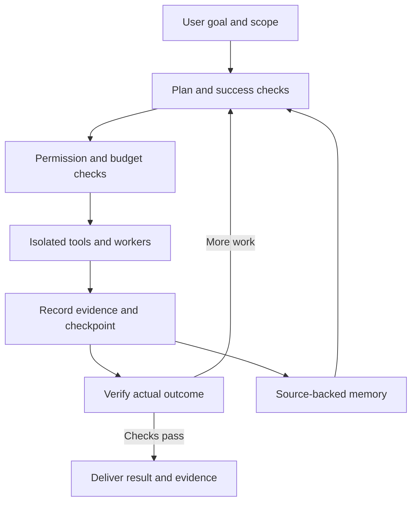

# Implementation checklist

Owner direction: execute on the host directly. Do not introduce containers, virtual machines, or an execution-isolation layer. This supersedes the isolation proposals in the original review below. Tool permissions, credential binding, cancellation and audit records still apply.

- [x] 01 Artifact path ownership and symlinks
- [x] 02 Immutable endpoint credential binding
- [x] 03 Retry repaired failed actions
- [x] 04 Fresh observations with checkpoint replay
- [x] 05 Cancellation and effect reconciliation
- [x] 06 Source-aware progress
- [x] 07 Duplicate delegation and graph cycles
- [ ] 08 Objective checks and evidence classification
- [ ] 09 Provenance, redaction and injection evaluations
- [ ] 10 Whole-operation deadlines and output limits
- [ ] 11 Bounded outages and parked tasks
- [ ] 12 Structured dependency plans and replanning
- [ ] 13 Evidence retrieval and persistent memory
- [ ] 14 Durable scheduling and supervised host worker
- [ ] 15 Direct host command and Python execution (replaces isolation)
- [ ] 16 Structured engagement permissions
- [ ] 17 Inventory/search/text pagination
- [ ] 18 Time, token, cost and tool budgets
- [ ] 19 Diagnostics and runtime metrics
- [ ] 20 Compact mission pagination and event/artifact export
- [ ] 21 Dependency/security checks and agent evaluations
- [ ] 22 Review open UI PR overlap without merging unrelated changes
- [ ] 23 Capability registry and availability checks
- [ ] 24 Browser and desktop adapters on the host
- [ ] 25 Cybersecurity evidence import and normalized findings
- [ ] 26 Specialist roles and model routing
- [ ] 27 Versioned file edits and rollback
- [ ] 28 Plan/evidence/memory/schedule dashboard
- [ ] 29 Voice input/output and vision-capable provider messages
- [ ] 30 Optional robotics bridge and emergency stop
- [ ] 31 Documentation, full validation and GitHub push

Each item is checked only after implementation and relevant automated validation. Optional adapters require their documented dependencies; live hardware/provider/desktop validation is tracked separately from fixture tests.

## Implementation log

- Reliability pass: original 78 Python tests pass; six new regression tests cover the seven reproduced issues. Host execution preference is recorded in AGENTS.md.

---

# Eliot: repository review and autonomous-agent roadmap

Reviewed 14 November 2026 (Asia/Kolkata). Repository: [modhack2003/Eliot_THE_AI](https://github.com/modhack2003/Eliot_THE_AI).

Snapshot: `main`, commit `c85c642211733109c04c7731c2f194d914a6c956`, package version `2.0.0a5`.

## Original review — historical recommendations

The original review is retained for context. The checklist above records current decisions and implementation status.

## Assessment

Eliot already implements a small autonomous cybersecurity agent: it accepts an objective, chooses registered tools, delegates workers, records evidence, checkpoints decisions, and asks a model to review completion. Its strongest starting points are the separation of chat from execution, persisted mission records, explicit network scope, typed tool inputs, and a local interface shared by the browser and terminal.

The current runtime is primarily an evidence-analysis agent. Nine registered tools cover files, reports, skill reading, one HTTP GET and limited nmap service discovery. The 83 bundled skills supply knowledge; they do not install or implement the tools their text discusses. The broader integrations under `legacy/` are outside the current entrypoint and should not be counted as current capabilities.

The practical goal should be: **give Eliot a goal and an operating scope; it plans, acts, observes, revises its plan, verifies the outcome, and delivers evidence of completion.** No runtime can reliably do literally every task. A clear capability inventory lets it distinguish work it can complete from a specific missing capability.

This review produced a backlog, not repository changes or published GitHub issues. Priority reflects the impact on the intended local autonomous-agent product, not a CVSS rating.

## Validation and boundaries

| Check | Result |
|---|---|
| Existing Python suite, Python 3.12.14 | 78 passed |
| Existing JavaScript transport suite | 11 passed |
| Syntax checks for app.js, workspace.js, neural.js and transport.js | Passed |
| Offline doctor | Required checks passed; all 83 skill modules passed pinned hash validation |
| Additional targeted checks | Seven problematic behaviors reproduced, detailed below |
| Repository state after review | No tracked changes |

The Python suite ran in an isolated environment installed from the repository's declared dependencies. It emitted a Starlette TestClient deprecation warning; pytest-asyncio also warns that its fixture loop scope is unspecified. These are maintenance items, not observed product failures.

All additional checks used temporary workspaces, synthetic markers, scripted model replies and mocked HTTP requests. No real model inference, real credentials, external assessment scans or nmap execution were used. nmap was unavailable in this review environment. I did not verify a physical robot, desktop control, voice interaction, actual provider reasoning quality, a Windows installation or the open UI PR branches. Passing existing tests does not establish those capabilities.

## Seven reproduced issues

### ELIOT-01 — Artifact symlinks bypass the intended file boundary

**Priority: P1. Security and correctness.**

Source: [agent_tools.py, artifact writing](https://github.com/modhack2003/Eliot_THE_AI/blob/c85c642211733109c04c7731c2f194d914a6c956/eliot_app/agent_tools.py#L170) and [artifact reading](https://github.com/modhack2003/Eliot_THE_AI/blob/c85c642211733109c04c7731c2f194d914a6c956/eliot_app/agent_tools.py#L192).

The implementation resolves the task artifact directory and checks that its resolved location stays inside the workspace. A task artifact directory that is itself a symlink to the workspace passes that test. This changes the effective artifact root from the intended task directory to the entire workspace. Artifact reads also bypass the ordinary evidence path denylist.

**Reproduction:** point `.eliot-artifacts/<task-id>` at the temporary workspace root. `read_artifact` then reads a synthetic `.env` file that `read_file` rejects. `write_artifact` creates `outside-artifacts.txt` directly at the workspace root.

**Limits:** this demonstration stayed inside the workspace. It requires a symlink in the artifact path, created by a local actor or concurrent workspace process; Eliot's ordinary write tool does not create symlinks. It does not demonstrate remote code execution or arbitrary filesystem escape.

**Fix:** reject symlinks/reparse points throughout artifact ownership paths, enforce the literal task-owned directory, and use race-resistant directory-relative file operations where supported. Apply consistent secret-file rules to artifact reads.

**Acceptance:** malicious parent/owner symlinks and path swaps cannot redirect reads or writes; normal artifact idempotency still works on Linux and Windows.

### ELIOT-02 — A provider snapshot can receive another endpoint's new key

**Priority: P1. Credential isolation.**

Source: [mission_runtime.py, saved provider selection](https://github.com/modhack2003/Eliot_THE_AI/blob/c85c642211733109c04c7731c2f194d914a6c956/eliot_app/mission_runtime.py#L172), [gateway.py, key lookup](https://github.com/modhack2003/Eliot_THE_AI/blob/c85c642211733109c04c7731c2f194d914a6c956/eliot_app/gateway.py#L51), and [web.py, profile updates](https://github.com/modhack2003/Eliot_THE_AI/blob/c85c642211733109c04c7731c2f194d914a6c956/eliot_app/web.py#L158).

Missions snapshot their original endpoint. Temporary credentials are looked up by mutable provider ID. Editing the profile clears its previous temporary key, but supplying a replacement key under that same ID makes it available to old mission snapshots too. Profile mutation guards inspect ordinary chat runs, not the mission runtime.

**Reproduction:** snapshot `original.example`, change profile `test` to `replacement.example`, and set a synthetic replacement-only key. Calling the old mission sends that key to `original.example`, observed through MockTransport.

**Fix:** bind credential handles to immutable provider identity and endpoint version. Require explicit rebinding when a mission must change credentials or provider configuration. Never persist raw keys in mission state.

**Acceptance:** an old mission cannot obtain a replacement endpoint's credentials; delete/recreate, profile editing, resume and restart paths all preserve the binding.

### ELIOT-03 — Failed actions are cached after the cause is fixed

**Priority: P1. Recovery and persistence.**

Source: [mission_runtime.py, action reuse](https://github.com/modhack2003/Eliot_THE_AI/blob/c85c642211733109c04c7731c2f194d914a6c956/eliot_app/mission_runtime.py#L269).

Any journal entry with status `done` is reused, including `{ok: false}`. Action identity is derived from the tool, arguments and recent feedback IDs. Resume does not generally invalidate failed action records.

**Reproduction:** `read_file('new.txt')` fails; create the file; repeat the same decision. The runtime returns `cached_action` with the old failure and does not read the now-existing evidence.

Feedback can change the action identity, but recovery should not depend on an unrelated feedback event.

**Fix:** separate logical step identity, execution attempts and effect idempotency. Retry eligible failed observations after a relevant change or explicit resume, with bounded retry rules. Preserve effect deduplication for operations that could produce external changes.

**Acceptance:** a corrected missing file/tool can be retried; replaying an already committed write does not duplicate its effect.

### ELIOT-04 — Successful observations remain stale for the mission

**Priority: P2. Evidence freshness.**

Source: [mission_runtime.py, action reuse](https://github.com/modhack2003/Eliot_THE_AI/blob/c85c642211733109c04c7731c2f194d914a6c956/eliot_app/mission_runtime.py#L270).

The same caching mechanism also reuses a successful file or HTTP observation after its underlying source changes. There is no explicit refresh argument, source revision key or observation TTL.

**Reproduction:** read a file, change its contents, and issue the same read. The cached old text is returned; the new content is not observed.

**Fix:** distinguish replaying a checkpointed observation from requesting a fresh observation. Track file hashes/revisions and network observation timestamps; provide an explicit refresh policy.

**Acceptance:** restart recovery reuses the committed result for the old step, while a new observation step can inspect changed data.

### ELIOT-05 — A local write can finish after cancellation without a journaled result

**Priority: P1 before adding broader side effects; P2 for the current confined report writer.**

Source: [agent_tools.py, thread dispatch](https://github.com/modhack2003/Eliot_THE_AI/blob/c85c642211733109c04c7731c2f194d914a6c956/eliot_app/agent_tools.py#L139) and [mission_runtime.py, cancellation/journaling](https://github.com/modhack2003/Eliot_THE_AI/blob/c85c642211733109c04c7731c2f194d914a6c956/eliot_app/mission_runtime.py#L277).

Local tools execute through `asyncio.to_thread`. Cancelling the awaiting coroutine does not stop an already-running thread. The coroutine exits before it journals the eventual tool result.

**Reproduction:** delay a synthetic artifact write inside its worker thread, cancel its awaiting task, then release the thread. The artifact appears after cancellation returns, while the evidence ledger remains empty for that action.

**Fix:** define and implement cancellation at each commit boundary. For short atomic writes, reconcile a committed result before acknowledging a settled stop; for cancellable work, use cooperative stop signals or supervised subprocesses. Report a settling state while an operation is finishing.

**Acceptance:** cancellation status and the effect ledger agree; no completed side effect is silently omitted. Repeat against real subprocesses in an isolated lab before expanding the toolset.

### ELIOT-06 — Distinct evidence sources are mistaken for stalled work

**Priority: P2. Progress detection.**

Source: [mission_runtime.py, result fingerprint](https://github.com/modhack2003/Eliot_THE_AI/blob/c85c642211733109c04c7731c2f194d914a6c956/eliot_app/mission_runtime.py#L289).

The novelty fingerprint removes source path and page-position fields. Identical text from different files therefore counts as the same result, even when checking those separate sources is necessary to the task.

**Reproduction:** read five separate files containing identical observations. The progress results are `[true, false, false, false, false]`. In the normal drive loop, four such non-progress results can block the mission.

**Fix:** measure progress against plan milestones and source provenance. Deduplicate content without discarding evidence-source coverage.

**Acceptance:** independently required sources count toward coverage; repeatedly rereading the same unchanged source still triggers the loop guard.

### ELIOT-07 — Repeated delegation evades the no-progress guard

**Priority: P1 for unattended missions.**

Source: [mission_runtime.py, child identity and progress](https://github.com/modhack2003/Eliot_THE_AI/blob/c85c642211733109c04c7731c2f194d914a6c956/eliot_app/mission_runtime.py#L301).

Child IDs include the coordinator's current step, so repeating the same delegation creates new children. Any completed child counts as progress, even if it repeats the same objective and evidence. Step/token budgets default to unlimited.

**Reproduction:** a scripted coordinator repeatedly delegates the same objective. With a deliberately finite 15-step test budget, five duplicate workers complete and the coordinator's stall counter remains zero. It stops on the explicit budget, not duplicate-work detection. The unlimited default therefore has no protection from this particular cycle.

**Fix:** identify delegations by objective, inputs, source revisions and completion criteria; reuse completed work when applicable. Add graph-wide cycle detection and useful-progress monitoring.

**Acceptance:** repeated identical delegation eventually reuses existing work or produces a precise blocker; intentional rechecks after changed inputs remain possible.

## Additional issues and design gaps

These are grounded in code inspection and current behavior, but were not reproduced as exploit scenarios or tested with a live reasoning model.

| ID | Priority | Finding | Improvement and acceptance target |
|---|---|---|---|
| 08 | P1 | Completion is approved by another call to the same provider, using the same persona and task context. Successful `read_skill` and `write_artifact` actions also qualify as evidence. A generated report is not independent proof of its claims. | Define objective-specific completion checks. Label observed inputs, generated artifacts and verified outcomes separately. A fabricated report alone must not satisfy an assessment objective. A separate reviewer model is optional additional scrutiny. |
| 09 | P1 before broader execution | Untrusted file/HTTP/skill text reaches the model. The fixed prompt states a hierarchy, but prose does not enforce semantic trust. No secret-value redaction or destination-aware data policy is implemented. | Tag provenance and trust, keep tool permissions enforced in code, redact sensitive values before model calls, constrain outbound data and add adversarial injection tests. Document residual risks instead of claiming prompt injection is solved. |
| 10 | P2 | `http_observe` uses an HTTPX timeout without an enclosing whole-operation deadline. A peer can keep delivering bytes below the read timeout. nmap output is size-checked after `communicate` has accumulated it. | Add total wall-clock deadlines, incremental output/decompression limits and verified cleanup for every tool. |
| 11 | P2 | Runtime transient provider retries have no maximum elapsed outage or retry count. Step budgets do not advance for repeated transport failures, so they may not end an outage loop. | Add outage deadlines, circuit breakers and explicit parked/waiting status. Permit approved failover without silently moving assessment data to another provider. |
| 12 | P2 | Plans are lists of text, not a dependency graph with step states, preconditions, inputs and expected outputs. | Persist structured steps and acceptance criteria, including why a replan is needed. Resume only affected steps after changed inputs. |
| 13 | P2 | Context includes recent events and evidence IDs but no general tool to retrieve any older action's full recorded result. Mission memory is one model-authored string; chat history is truncated by counts/characters. | Add evidence lookup by ID, retrieval by source and task, factual summaries with provenance and model-aware context budgeting. |
| 14 | P2 | Missions run in the web backend process. SQLite recovery exists, but there is no independent daemon scheduler, worker lease or distributed execution layer. | First add a supervised local worker and durable queue. Keep SQLite for a single user; add leases, a production database or additional workers only when workload needs them. |
| 15 | P2 | There is no execution isolation layer beyond application path/tool validation. | Before adding terminal or code execution, introduce isolated workers with read-only evidence mounts, controlled writable outputs, CPU/RAM/time limits and network scope enforcement. |
| 16 | P2 | Scope is a network boolean plus exact host names/IPs. It does not express allowed ports, URL paths, credentials, operation types, time windows or resolved address identity. | Introduce a structured engagement policy enforced by every adapter. Record resolved addresses; define how scope changes when DNS or targets change. Preserve explicitly authorized private lab targets. |
| 17 | P2 | File inventory caps at 500, search uses that inventory and caps matches at 40, and text pages can truncate mid-line at 12,000 characters. Cursor-based retrieval is missing. | Add stable cursors, source-version checks, byte/chunk offsets, truncation metadata and exhaustive-search indicators so Eliot can account for uninspected material. |
| 18 | P2 | Budgets exist for tokens/steps, but no wall-clock or monetary budget, per-tool rate budget or reservation of concurrent in-flight usage is implemented. | Add configurable budgets and progress-aware stopping. Preserve explicit unlimited mode where desired, while showing actual/estimated usage honestly. |
| 19 | P2 | Unexpected tool errors become a generic message and unexpected runtime errors lack internal diagnostic detail in the recorded event. Synchronous SQLite reads/writes occur on async request/mission paths. | Add redacted structured internal logs and trace IDs, per-step latency metrics, indexed/paginated queries and off-loop database access where measured load warrants it. |
| 20 | P2 | `/api/tasks` returns complete mission rows, including state and provider snapshots, for up to 200 missions, and the browser repeatedly polls this list. Older missions lack list pagination. | Return compact summaries, paginate history and fetch details on demand; use task event streaming when valuable. Keep the event log readable without transferring every pending decision each poll. |
| 21 | P2 | Dependency ranges are broad, no lock file is present, and current workflows emphasize functional/installation checks. No agent-quality benchmark or dedicated dependency/security scan is defined there. | Add a reproducible dependency strategy, update automation, dependency/secret/static scans and behavior evaluations. Passing unit tests must remain separate from measured autonomous task success. |
| 22 | P3 | Two open PRs, #3 and #4, focus on neural-core graphics. They do not establish missing agent capabilities. | Review overlap and compatibility separately. Prioritize the execution/recovery backlog before more animation work. This review did not inspect or approve either PR's implementation. |

Sources for this inspection include [instructions.py](https://github.com/modhack2003/Eliot_THE_AI/blob/c85c642211733109c04c7731c2f194d914a6c956/eliot_app/instructions.py), [mission_store.py](https://github.com/modhack2003/Eliot_THE_AI/blob/c85c642211733109c04c7731c2f194d914a6c956/eliot_app/mission_store.py), [web.py](https://github.com/modhack2003/Eliot_THE_AI/blob/c85c642211733109c04c7731c2f194d914a6c956/eliot_app/web.py), [store.py](https://github.com/modhack2003/Eliot_THE_AI/blob/c85c642211733109c04c7731c2f194d914a6c956/eliot_app/store.py), [workspace.js](https://github.com/modhack2003/Eliot_THE_AI/blob/c85c642211733109c04c7731c2f194d914a6c956/eliot_app/static/workspace.js), [pyproject.toml](https://github.com/modhack2003/Eliot_THE_AI/blob/c85c642211733109c04c7731c2f194d914a6c956/pyproject.toml) and the two CI workflow files.

## Features that move Eliot toward the intended agent

| Order | Feature | Concrete behavior |
|---|---|---|
| 1 | Goal intake and completion contract | Turn a natural-language objective into deliverables, success checks, scope, available credentials and missing prerequisites. Infer routine details; ask only when a decision materially affects permission or outcome. |
| 2 | Durable planner and replanner | Build a dependency graph, track completed work, choose the next useful step, detect blocked prerequisites, and revise the graph when evidence changes. |
| 3 | Capability registry | Every tool declares input/output schemas, effects, required permissions, environment requirements, timeout, retry behavior and verification method. Show installed, available and missing tools honestly. |
| 4 | Isolated execution | Run approved terminal commands, Python scripts and analysis tools inside controlled per-task workers. Provide typed common actions before a general command adapter. |
| 5 | Browser and desktop tools | Inspect a DOM, navigate, fill forms, capture a screenshot when needed, and verify resulting state. Add desktop/vision fallback for interfaces without useful DOM access. Bind credentials to the correct account and destination. |
| 6 | Better cybersecurity workflows | In authorized labs, ingest code/configuration, dependency manifests, HAR/logs and standard scanner exports; normalize findings; deduplicate; separate observations from verified findings; generate reproducible reports. Migrate individual legacy adapters only after review and tests. |
| 7 | Source-backed memory | Maintain task, project and user memory separately; retrieve evidence with hashes, timestamps and trust labels; let the operator inspect, correct and delete remembered facts. Avoid retaining raw secrets. |
| 8 | Outcome verification | Check actual files, test results, API state or observed UI state against the completion contract. Include unresolved work and evidence links in the final report. |
| 9 | Specialist workers | Add researcher, code reviewer, log analyst and verifier roles with task-specific context and narrower capabilities. Existing delegation is a foundation; introduce deeper nesting only when evaluation shows a benefit. |
| 10 | Model routing | Choose models by measured task performance, context limits, latency and cost. Offer provider-native structured output/tool calls when supported and retain validated text JSON as a compatibility fallback. |
| 11 | Scheduling and triggers | Run a mission at an agreed time or after a project event. Use durable jobs with deduplication, execution history and cancellation. |
| 12 | Checkpoints and rollback | Preview file changes, preserve versions, reconcile interrupted side effects and support compensation where an operation is reversible. Do not promise universal rollback for external actions. |
| 13 | Mission dashboard | Show the plan graph, current step, evidence, costs, worker status, blockers and artifacts. Add artifact open/download and exportable mission records. |
| 14 | Voice and vision | Speech input/output, interruption and screenshot understanding after the execution core works reliably. These improve interaction; they do not establish autonomous reliability. |
| 15 | Robotics bridge, if physical hardware is intended | Add device adapters, sensor/actuator schemas, simulated tasks, physical limits, watchdogs and an independent emergency stop. Keep real-time motor control in a dedicated controller rather than an LLM loop. This is a separate subsystem, not present in the reviewed runtime. |

## Proposed control flow

A task-scoped autonomy policy should authorize routine actions once, permit Eliot to choose steps within that policy, and require a new decision only when the requested action falls outside it. For example, it could independently analyze an engagement folder, run allowed checks in its worker, compare evidence and produce a report. Publishing, spending money, contacting people or changing unrelated systems would follow whatever separate authority the operator explicitly granted.

## Implementation sequence

### Phase 1: Make the current alpha dependable

Fix ELIOT-01, 02, 03, 04, 05, 06 and 07, with regression coverage for each. Add structured error records and operation deadlines. Preserve the existing chat/task separation, key redaction, explicit scope, pinned skills, checkpoint recovery and transport recovery.

**Exit criteria:** old missions cannot consume another endpoint's credentials; artifact boundaries hold; fixed blockers can be retried; fresh observations are possible; cancellation and journals agree; duplicate work is stopped without suppressing valid source coverage.

### Phase 2: Build the core autonomous task contract

Add structured plans, acceptance checks, evidence retrieval, capability metadata, context management and configurable budgets. Measure outcomes with scripted fixtures and a small approved live-model benchmark.

**Exit criteria:** a multi-step evidence task resumes after a crash, completes required coverage, catches unsupported claims, and either produces a verified result or names the missing prerequisite.

### Phase 3: Expand what Eliot can execute

Introduce isolated workers, reviewed command/code tools, browser automation and useful cybersecurity file/tool adapters. Add per-tool permissions and credential bindings before granting broader effects.

**Exit criteria:** repeatable authorized lab workflows produce the expected outputs, stay within the configured scope and stop cleanly during tool execution.

### Phase 4: Add long-running intelligence and richer interaction

Add project memory, specialist roles, model routing, schedules, rollback support, outcome-oriented dashboard views, then voice/vision. Build robotics separately if a physical device is intended.

**Exit criteria:** quantify task success, recovery success, false completion, duplicate work, intervention rate, scope violations, latency and cost. Show improvement against a fixed benchmark before expanding permissions.

Keep the existing Python/FastAPI architecture for this work. A wholesale rewrite or framework migration is not required to implement the prioritized fixes.

## Minimum evaluation set

1. Missing evidence appears after an initial read failure; resume reads it successfully.
2. A file changes after an observation; a fresh step retrieves the new version.
3. Five required sources have identical content; the task still verifies all sources.
4. A planner repeats the same delegation; completed work is reused and the cycle is stopped.
5. A provider endpoint changes and receives a new key; old snapshots cannot access it.
6. Artifact directories contain symlinks/reparse points; the tools reject boundary violations.
7. Stop arrives during a write or subprocess; the final state and effect ledger match reality.
8. Crash occurs before/after a side-effect commit; recovery reconciles the result without duplicate effects.
9. Retrieved text contains a hostile instruction; tool policy still blocks unauthorized actions and test output records any attempted policy violation.
10. A report cites only its own generated contents; objective verification refuses unsupported completion.
11. A provider remains unavailable; the task parks with a useful outage reason and respects its configured outage policy.
12. A tool drips output indefinitely or produces too much output; its whole-operation deadline and output limits terminate it.

OWASP's Agentic Top 10 is a useful external threat-model reference for goal hijacking, tool misuse, identity/privilege abuse, poisoned memory and cascading failures. It informs the proposed evaluation coverage; it does not establish that every category is a confirmed vulnerability in Eliot. Official reference: [OWASP Agentic Top 10 announcement](https://genai.owasp.org/2025/12/09/owasp-top-10-for-agentic-applications-the-benchmark-for-agentic-security-in-the-age-of-autonomous-ai/).
